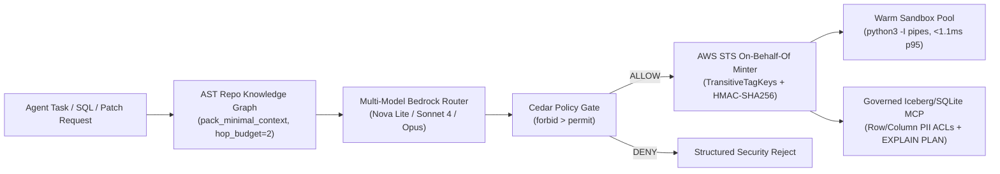

# ForgeRuntime — Sandboxed Coding & Governed Data-Lake Agent Platform

> **☁️ Live AWS Deployment (`us-west-2` Lambda Function URL):** [https://w6jkm2tnqcysmunvv72awnziya0dqlxn.lambda-url.us-west-2.on.aws/](https://w6jkm2tnqcysmunvv72awnziya0dqlxn.lambda-url.us-west-2.on.aws/)  
> **Health Check:** `https://w6jkm2tnqcysmunvv72awnziya0dqlxn.lambda-url.us-west-2.on.aws/api/health` · **Live Execution API:** `curl -s -X POST https://w6jkm2tnqcysmunvv72awnziya0dqlxn.lambda-url.us-west-2.on.aws/api/run -H 'Content-Type: application/json' -d '{}'`

[](https://ritwikareddykancharla.github.io/forge-runtime/)
[](https://www.python.org/)
[-brightgreen.svg)](#quick-start)
[-success.svg)](#3-cedar-policy-engine-aws-sts-on-behalf-of--warm-sandbox-pool)
[-orange.svg)](#1-ast-repo-knowledge-graph--minimal-context-packer)

> **Live Interactive Simulator**: [**`https://ritwikareddykancharla.github.io/forge-runtime/`**](https://ritwikareddykancharla.github.io/forge-runtime/) — Explore the 2-Hop AST Repo Knowledge Graph, SLA/Cost Multi-Model Router, Cedar + AWS STS `On-Behalf-Of` + Warm Sandbox Lab (`10/10` escape vectors), and Governed Apache Iceberg / SQLite MCP Studio directly in your browser.

**`ForgeRuntime`** is a standalone, zero-external-dependency Python runtime for **IDE coding agents**, **isolated code-execution sandboxes**, **deterministic IAM/Cedar policy enforcement**, and **governed Apache Iceberg / SQLite data-lake analytics over MCP**.

Every subsystem runs deterministically out-of-the-box using Python 3.10+ stdlib (`ast`, `sqlite3`, `subprocess`, `select`, `hmac`, `hashlib`), while providing wire-compatible **`boto3` (`bedrock-runtime` Converse + `sts` `AssumeRole`)** and **`strands-agents`** tool-spec adapters in `forge_runtime/adapters.py`.

---

## Architecture Overview



---

## Core Engineering Pillars

### 1. AST Repo Knowledge Graph & Minimal Context Packer (`forge_runtime/ast_graph.py`)
- Indexes any Python codebase (`ASTRepoGraph.from_directory` or `from_sources`) into typed symbol nodes (`Module`, `Class`, `Function`) and directed edges (`CALLS`, `IMPORTS`, `INHERITS`), resolving `self.<attr>` collaborator types, parameter annotations, and `super()` inheritance chains.
- **`pack_minimal_context(symbol_query, hop_budget=2)`**: Emits the exact AST implementation slice for the focal symbol (`Hop 0`) plus typed signatures and docstring contracts for `Hop 1` and `Hop 2` callers/callees/base classes—eliminating full-file context bloat while preserving **100.0% call-neighborhood recall** (`5.30x` compression vs. touched full files; `5.97x` vs. full repository).

### 2. Complexity-, Token-, & SLA-Aware Multi-Model Router (`forge_runtime/model_router.py`)
- Computes structural complexity scores across cyclomatic complexity, AST hop depth, files touched, token volume, and lexical intent, routing across:
  - `bedrock/amazon.nova-lite-v1` — Fast AST symbol lookup, lint fix, syntax check, and strict `<350ms` IDE autocomplete SLAs.
  - `bedrock/anthropic.claude-sonnet-4` — Standard multi-line patches, governed Iceberg SQL synthesis, Cedar policy authoring, and unit test generation.
  - `bedrock/anthropic.claude-opus` — Multi-file architectural refactors, distributed concurrency debugging, and security boundary redesigns.
- Enforces hard **`sla_max_p95_ms`** and **`max_cost_usd`** guardrails, stepping down tiers deterministically with explicit audit rationales.

### 3. Cedar Policy Engine, AWS STS On-Behalf-Of & Warm Sandbox Pool (`forge_runtime/cedar_sts_gate.py`)
- **Deterministic Cedar Policy Evaluator (`CedarPolicyEngine`)**: Parses `permit` and `forbid` rules with `when { ... }` and `unless { ... }` AST boolean guards (zero `eval()`), enforcing **implicit default `DENY`** and unconditional **`forbid`-overrides-`permit`** precedence (e.g., blocking `Action::"DropTable"` even when broad admin permits match, and blocking prod mutations unless `context.human_approved == true`).
- **AWS STS `On-Behalf-Of` Session Token Minter (`STSOnBehalfOfMinter`)**: Mints `HMAC-SHA256` signed `AssumeRole` session claims binding `PrincipalTag:ApprovedBy`, `PrincipalTag:AgentId`, `PrincipalTag:RiskRung`, and `CloudTrailCorrelationId` across `TransitiveTagKeys`, detecting privilege-escalation tag tampering in constant time (`hmac.compare_digest`).
- **Warm Sandbox Pool vs. Cold Subprocess Executor (`WarmSandboxPool`)**: Pre-warms isolated `python3 -I` OS worker processes with pre-loaded allowlisted stdlib modules communicating over persistent stdio pipes. Enforces 2-layer containment (pre-flight AST scanner + restricted `__builtins__` & guarded import hook) plus a `select`-based watchdog that kills and replaces runaway infinite-loop workers automatically.

### 4. Governed Iceberg / SQLite Data-Lake MCP Server (`forge_runtime/governed_lake_mcp.py`)
- Implements `list_tables`, `describe_lineage`, and `validate_and_query_sql` over seeded `ads_campaigns`, `customer_billing`, and `agent_telemetry` tables with Apache Iceberg snapshot metadata, partition specs, and column sensitivity classifications (`PUBLIC`, `INTERNAL`, `PII_CONFIDENTIAL`, `PII_RESTRICTED`, `PCI_RESTRICTED`).
- Enforces four pre-execution gates:
  1. **Read-Only SQL Safety**: Comment-stripping lexical + multi-statement blocker rejecting `DROP`, `DELETE`, `UPDATE`, `INSERT`, `ATTACH`, `PRAGMA`, etc.
  2. **Column-Level PII/PCI ACLs**: Uses SQLite's C-engine `conn.set_authorizer` callback (`SQLITE_READ`) during query compilation to block unauthorized reads of `customer_email`, `raw_card_token`, `tax_ein_ssn`, and `caller_ip`—even through `SELECT *`, table aliases, or CTEs.
  3. **Row-Level Tenant & Sovereign Region Isolation**: Injects parameterized `_rls_<table>` CTE filters scoping queries to the caller's authorized `region` (`NA`, `EMEA`, `APAC`) and `advertiser_id`.
  4. **Schema-Contract Pre-Validation**: Runs `EXPLAIN QUERY PLAN` prior to execution, catching hallucinated columns/tables before execution (`100.0%` valid pipeline execution).

---

## Verified Benchmark Metrics (`benchmarks/latest_results.json`)

Generated on Python `3.14.6` (`macOS arm64`, zero external dependencies) via `python3 benchmarks/run_benchmarks.py`:

| Subsystem & Metric | Verified Benchmark Value | Baseline / Comparison |
| :--- | :---: | :---: |
| **AST Minimal Context Compression (`hop_budget=2`)** | **`5.30x`** (`733.7` vs `3,887.0` tokens) | **`5.97x`** vs. full repo (`4,382.0` tokens) |
| **AST 2-Hop Call-Neighborhood Recall** | **`100.0%`** | `20.48%` naive single-file stuffing |
| **Multi-Model Router Tier Accuracy (12-Task Suite)** | **`100.0%`** (`12/12`) | Enforces hard SLA & USD caps |
| **Multi-Model Router Cost & Latency Reduction** | **`35.89%` lower cost / `59.71%` lower p50** | vs. static `claude-opus` baseline |
| **Cedar Policy Invariant Accuracy (`forbid` > `permit`)** | **`100.0%`** (`4/4` scenarios) | Blocks `DropTable` & unapproved prod writes |
| **AWS STS OBO `HMAC-SHA256` Tamper Detection** | **`100%` Verified (`SIGNATURE_TAMPERED`)** | Binds 4 `TransitiveTagKeys` |
| **Warm Sandbox Pool Dispatch Latency (`p50` / `p95`)** | **`0.625 ms` p50 / `1.077 ms` p95** | **`61.9x` faster** than cold spawn (`38.694 ms` p50) |
| **Adversarial Escape Containment (10 Attack Vectors)** | **`100.0%`** (`10/10` blocked) | Blocks `os`, `socket`, `/etc/passwd`, dunders & CPU spin |
| **Governed Lake MCP Gate & Schema-Contract Accuracy** | **`100.0%`** (`8/8` cases) | `100.0%` `EXPLAIN QUERY PLAN` pre-validated |

---

## Quick Start & JSON CLI Modes

Every CLI mode emits clean, deterministic JSON suitable for both terminal inspection and live web-backend execution:

```bash
# Run the full 12-test unit & security suite (zero external dependencies)
python3 -m unittest discover -s tests -v

# Regenerate benchmarks/latest_results.json
python3 benchmarks/run_benchmarks.py

# Live JSON CLI modes
python3 -m forge_runtime.cli --mode demo-all
python3 -m forge_runtime.cli --mode ast-graph
python3 -m forge_runtime.cli --mode model-router
python3 -m forge_runtime.cli --mode cedar-sts
python3 -m forge_runtime.cli --mode sandbox-bench
python3 -m forge_runtime.cli --mode lake-mcp
```
