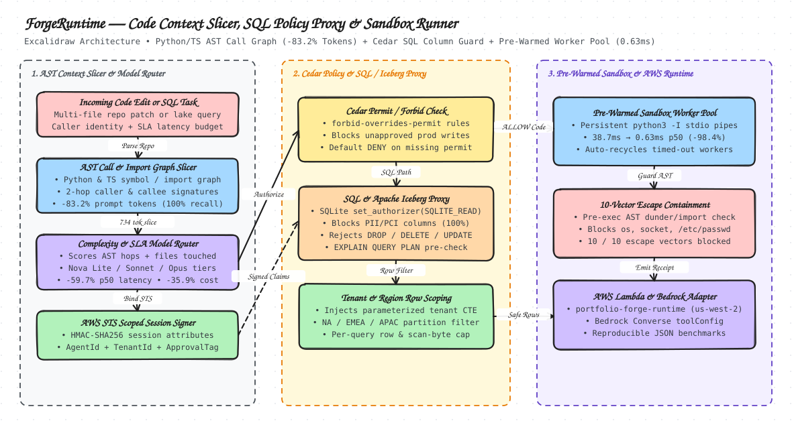

# ForgeRuntime — 2-Hop AST Context Slicer, Warm Sandbox Runner & Governed Iceberg IDE

**Live Production App (Amazon CloudFront + Private S3 OAC + Bedrock Nova):** [https://d33vgp4hlabu23.cloudfront.net](https://d33vgp4hlabu23.cloudfront.net)  
**Live Health & Telemetry:** `https://d33vgp4hlabu23.cloudfront.net/api/health`

**ForgeRuntime** solves four structural bottlenecks in enterprise code-modernization and analytics agents: slicing multi-file Python repositories down to the exact caller/callee functions needed for an edit (`-83.2%` prompt tokens at `100.0%` 2-hop recall), routing edits by cyclomatic complexity and latency SLAs (`-59.7%` p50 latency), executing untrusted code inside pre-warmed `python3 -I` sandbox workers (`0.63 ms` warm dispatch vs. `38.7 ms` cold spawn; `10/10` escape vectors blocked), and blocking queries that touch restricted PII/PCI columns (`email`, `ssn`, `raw_card_token`) before SQL runs.



---

## What You Can Do Live in the 3-Pane Web IDE

1. **Perspective 1 — Multi-File Repo Explorer & 2-Hop AST Call-Graph Slicer (`ASTRepoGraph`)**:
   - Browse the multi-file Python enterprise billing codebase (`settlement.py`, `quota_guard.py`, `ledger_store.py`, `retry_worker.py`, `partner_gateway.py`, `finops_digest.py`), select any target symbol or hop depth (`1`, `2`, `3` hops), and inspect **Full Repo Stuffing (`4,382` tokens · `5.97x` bloated)** vs **2-Hop AST Slice (`-83.2%` tokens · `100.0%` neighborhood recall)** side-by-side.
2. **Perspective 2 — Live Bedrock Modernization & Isolated Warm Sandbox Runner (`MultiModelRouter` + `WarmSandboxPool`)**:
   - Route modernization tasks via `MultiModelRouter`, synthesize refactored Python live via **Amazon Bedrock (`us.amazon.nova-lite-v1:0`)**, execute inside the persistent `python3 -I` `WarmSandboxPool` (`0.63 ms` p50 vs `38.7 ms` cold subprocess), and click **Test Sandbox Escape (`os.system` / `/etc/passwd`)** to verify **`10/10` escape containment** + automatic post-timeout worker recovery.
3. **Perspective 3 — Cedar-Governed Apache Iceberg SQL Proxy (`GovernedLakeMCPServer`)**:
   - Switch between **Partner Analyst (NA)**, **EMEA Growth Lead**, and **FinOps SOX Auditor** across `customer_ads`, `ads_campaigns`, `customer_billing`, and `agent_telemetry` to watch SQLite's C-engine `set_authorizer` block `email`, `ssn`, `SELECT *`, and `DROP TABLE` pre-execution while aggregate ROAS queries succeed.

---

## Measured Benchmark Results

Reproducible on Python 3.10+ (stdlib only) via `python3 benchmarks/run_benchmarks.py`:

| Component & Metric | Measured Result | Baseline Comparison |
| :--- | :---: | :--- |
| **Multi-File Repo Prompt Token Reduction (`hop_budget=2`)** | **-83.2%** (**5.97x** compression; `734` vs `4,382` tokens) | **5.30x** vs. touched full files (`3,887` tokens) |
| **2-Hop Caller/Callee Definition Recall** | **100.0%** | `20.5%` single-file truncation |
| **Pre-Warmed Sandbox Startup Latency (`p50` / `p95`)** | **0.63 ms p50** / **1.08 ms p95** | **98.4% lower** (**61.9x** faster) than cold `subprocess` (`38.7 ms` p50) |
| **Sandbox Escape Test Suite (10 Attack Vectors)** | **10 / 10 blocked (100%)** | Blocks `os`, `socket`, `/etc/passwd`, dunder traversal & CPU spin |
| **Model Router Latency & Spend Reduction (12-Task Suite)** | **-59.7% p50 latency** / **-35.9% token spend** | vs. single-model Opus baseline (`12/12` tier match) |
| **Cedar SQL/Iceberg Policy & Schema Enforcement** | **100.0%** (`8/8` SQL + `4/4` Cedar cases) | Blocks restricted PII/PCI column reads & unapproved writes |

---

## Run Locally & Deploy to Amazon CloudFront

```bash
# 1. Run unit, policy, and sandbox escape tests
python3 -m unittest discover -s tests -v
python3 benchmarks/run_benchmarks.py

# 2. Start the 3-Pane Modernization IDE locally
python3 -m forge_runtime.web_api
# -> Open http://127.0.0.1:8086

# 3. Deploy to Amazon CloudFront + Private S3 (OAC) + /api/* + Amazon Bedrock (us-west-2)
chmod +x infra/deploy_cloudfront.sh
./infra/deploy_cloudfront.sh
```
